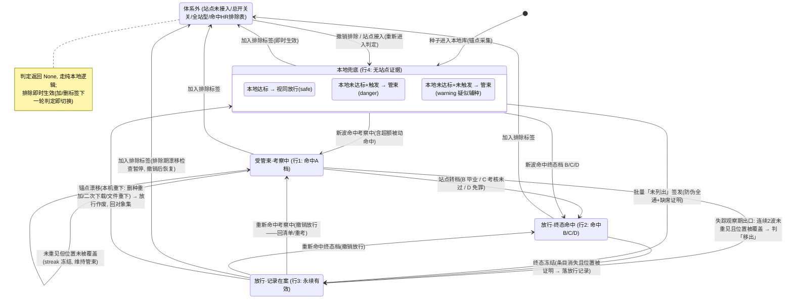

# HR 在线核实 — 权威文档

> **本文档是「HR 在线核实」的唯一权威口径**，结合代码（`src/auto_qb/hr/` 及消费侧）与全部历史文档整理而成。
> 文档设计 > 代码：两者不一致时以本文档为准，差异记入 §12「已知不一致（BUG 记录）」。
> 旧文档（历史计划 / 任务档案 / 审计报告 / 旧版 docs）已全部退役，见 §13。
> 本文档随代码演进**持续同步更新**，无日期版本号；历史细节需要考古时再去 memory-bank 按 §13 的清单查。

---

## 1. 定位与一句话

部分 PT 站只对**一部分**种子计 H&R，且不提供可机读的逐种标记 —— 只能上站查。`hr_check` 为此而生：
**浏览器扩展在真实登录态下代取 HR 统计页与 `.torrent`，后端零 cookie、零直连站点，对账建索引后按硬编码判定表对每个本地种子出结论 —— 受管束 / 放行 / 无证据本地兜底。**

三条设计公理（一切机制由此推出）：

1. **站点是权威**：命中档位即站点结论，本地数值不得越级推翻；被动命中「考察中」本地达标与否都管。
2. **证据无时效、只有真伪**：终态不可逆，放行永续有效；反转必然伴随重新下载（本机重下由锚点漂移作废；非本机重下是接受的残余风险）。
3. **保守方向**：漏管束的代价远大于多管一个 / 多发一次请求 —— 判定合并、下载触发、覆盖余量全按保守取。

---

## 2. 总体架构

```
浏览器扩展(MV3, extensions/hr-fetch-proxy)
   │  拉任务 / 回传页面 DOM 与 .torrent 字节(登录态, cookie 不出浏览器)
   ▼
本地端点线程(127.0.0.1:8788, 只入队; token + origin 白名单 + URL 白名单)
   ▼
取数线程(60s 自唤醒, 与主循环节拍无关)
   持站点锁 → 波前现算 → 各闸放行 → A/B/C 轮流翻页 → 行处理/下载 → 防伪 → 放行/观察期 → 写盘 → 发布视图
   ▼
只读视图(HrViewPublisher 原子发布, 实质变化才抬 revision)
   ▼
主循环 / Web 线程(只读视图, 经 TorrentRecord.hr_link 现算判定; 不写、不 API、零等待)
```

- **线程三分职责（硬约束）**：端点线程只入队；取数线程持锁抓数、解析、写盘、发布视图；主循环只读视图做判定。取数线程**不碰 state_file / 任务队列 / 种子 store**，只读写 `hr/` 目录与视图对象。
- **视图发布**：状态存于单个元组 `(revision, signature, views)`，读方一次属性读取拿全，无撕裂；参与指纹的只有会改变判定结果的量（revision / 通道状态 / healthy_ts / 清单与放行规模 / listing）。冷启动**先发布磁盘既有结论再开第一波**，杜绝重启后的「判定真空期」。
- **多实例**：站点文件放共享目录（`hr_check.shared_dir`，云同步盘不可用），每站点一把文件锁 + 复用窗去重；同机多实例各用不同 `channel.port`。有浏览器的实例建议都开 `channel`（不会双倍访问站点，只消掉「只有一台能抓」的单点）；无通道实例 `allow_fetch=False`，只读共享数据。
- **锚点交接三态契约**：主循环以不可变数据向取数线程交接本地锚点 —— `None`=采集失败/未知（**不构成稳态**，不把「不知道」当「零种子」）；`{}`=确认该站零锚点（可降频）；非空映射=正常对账。
- **站点完全隔离**：每站点一个站点文件、一把锁、一本频控账本；单站点失败不拖垮其它站点。

---

## 3. 配置口径

### 3.1 键位总表（v3 15 键）

| 层 | 键 | 默认 | 说明 |
|---|---|---|---|
| 全局 `config.hr_check` | `enabled` | false | 总开关（保守默认）；关 = 全体回到既有本地行为，零静默变更 |
| | `min_interval` | 90S | 相邻请求最小间隔，页面与 `.torrent` 统一适用；抖动只向上 +0~25%（实测间隔恒 ≥ 本值） |
| | `max_requests_per_day` | 240 | 站点级日额保险（页面 + 下载合计，零点重置）；只防长跑超量，不是节奏工具 |
| | `max_pages_per_wave` | 30 | 单波页数上限安全阀；到顶该档截断（截断点之前有效），下波从头再翻 |
| | `allow_window` | 空 | 仅该时段取数（可跨午夜）。❗与 `notify.quiet_hours` 语义**相反** |
| | `shared_dir` | 空 | 多实例共享目录；留空落 `<data_dir>/hr/` |
| | `reuse_window` | 2H | 数据复用窗（波后新鲜窗）；实际生效 = min(本值, 拉取间隔) |
| | `channel` | — | 取数通道对象（见 §8） |
| 通道 `hr_check.channel` | `enabled` | false | 本实例是否装了扩展 |
| | `port` | 8788 | 仅监听 127.0.0.1；同机多实例必须各不相同，被占启动即报错 |
| | `token` | 空 | 留空 = 首启随机生成并持久化到 `<data_dir>/hr.token` |
| | `extension_id` | 空 | 第二道防线（32 位 a~p）；留空启动时 WARNING 提醒 |
| | `request_timeout` | 180S | 等扩展回传上限；必须有（否则扩展中途被关会让持锁线程永久挂住） |
| 站点 `hr_check.sites.<档案id>` | `enabled` | false | **启用即管**，判定语义硬编码无撤退路径 |
| | `tracker` | 空 | 显式绑定站点条目名；留空 = 档案按 announce 域自动映射（0 命中或 ≥2 命中配置期报错） |
| | `refresh_interval` | 12H | 拉取间隔：自上次**健康波**起的对账节奏；「立即拉取」可越过本闸（频控仍生效） |
| | `idle_refresh_interval` | 24H | 稳态拉取间隔（§7）；须 ≥ 拉取间隔，相等 = 等效关闭降频 |

- **站点接入 = 档案点选**：键必须是 `config/site_presets.py` 里已登记的档案 id（当前 `btschool` / `carpt`）；页面地址、解析器、下载路径、翻页参数、清单形态由档案填充，配置里写这些值不再被接受。未入档案的站点配置期直接报错。
- **绑定 = 映射**：web 域与 announce 域是两个命名空间，**永不互相比对**；默认映射查表恰好 1 命中即零配置绑定。绑定的站点还必须配置 `hr` 规则段，否则该站 HR 判定前置条件恒为假。
- **旧键**：`trackers.<站点>.hr_check` 已废除，config v1→v2 迁移自动改写，v2→v3 把 `mode: partial/all` 转 `enabled: true`；v3 起出现即直接删除，无常驻兼容。
- **频控键全在全局**：站点级频控键已随 v3 删除（`HrLimits.merge` 只读全局）。
- **程序能定的绝不配置**：覆盖余量 1D、到期段阈值 5 行、超额线 3×、观察期 2 波、守恒下限 70%、粗配 K=12、页数安全阀之外的引擎参数全部常量化。

### 3.2 HR 排除表（`trackers.<站点>.hr.exclude_tags / exclude_categories`）

命中排除表的种子**不纳入 HR 体系**，优先级最高——压过站点侧一切管束与放行：

- **判定侧**：`record.hr_excluded()` 现算（在 qB 加/删标签下一轮判定即生效/恢复），四个判定入口（`hr_managed` / `check_hr_condition` / `check_hr_satisfied` / `hr_judgement`）顶部各一行短路；`hr_judgement` 返回 None ⇒ 与「站点未接入」呈现同构。
- **取数侧**：锚点带 `excluded` 标记，被排除种子**不进对账对象集**（否则对象集恒非空、稳态降频永不生效）；排除只在这里生效——命中识别用的 `local_hashes` 仍从全量锚点构建（排除 ≠ 不认识），名称候选面另行收窄为受管集。
- 撤销排除后种子重新进对象集，漂移检查随之恢复，**不产生不可逆残留**（排除种子的放行记录不被锚点漂移作废）。

---

## 4. 数据模型与站点文件

站点文件 `<站点>.json`（`<data_dir>/hr/` 或 `shared_dir` 下）承载**全部账号级状态**（与实例数无关，故不进 state_file），由实例共享。schema 版本由 `infra.versioning` 统一管理；读到比程序新的版本（版本回退）⇒ 跳过取数与写盘，等程序升级。

| 字段 | 语义 |
|---|---|
| `index: {tid: HrEntry}` | 站点清单快照（主键 `(站点, tid)`；`dl_id` 是下载用种子 id——CarPT 等站 H&R ID 与种子 id 是两个 id 空间）。行字段含档位 lane、上传/下载量、ratio、`need_seed_seconds`、`done_iso`、`remain_seconds`、infohash v1/v2、`first_seen` / `last_seen`、`active`、`missing_streak` |
| `downloaded: {tid: HrDownloaded}` | **永久层**已取记录：「永不重下」的持久凭据（条目消失/翻页遗漏/快照淘汰都不重下） |
| `fails: {tid: HrDlFail}` | 单条 `.torrent` 取数失败记账（达 3 次后冷却 1h，防烧配额） |
| `verified: {infohash: HrVerified}` | 放行记录：infohash、tid、签发时刻、来源 source、**锚点快照**（供本机重下作废用） |
| `wave: HrWaveMeta` | 最近一波元数据：`wave_ts` / `healthy_ts`（节奏基准）/ `idle_mode`（稳态旗标，仅翻转时写盘）/ 各档 `HrLaneState` / `releases_enabled` / `zero_rows` / 守恒观测 / 上波 A 档 tid 集 |
| `rate: HrRateLedger` | 频控账本：日窗口键（幂等靠窗口键——重启不重置、重放不重复消耗）+ 日计数 + `last_fetch_ts` |
| `empty_confirmed_at` | 人工对账戳（零行波签发钥匙） |
| `retry_after_until` | 站点 Retry-After 指令（不是退避机制） |
| `history` | 拉取历史事件表（纯观测不入判定；容量 2000 条 / 6 个月，追加前修剪） |

**时间字段语义（易混，明写）**：

- `fetched_at`：上次**尝试**取波时刻（失败也前进——「上次动过是什么时候」）；
- `wave.healthy_ts`：上次**健康波**（至少一档有有效数据）时刻——拉取节奏与新鲜度的**唯一基准**，失败波不推进 ⇒ 失败档下一轮（60s）自然重试；
- `expires_at`：复用窗截止；有效波才设窗（= now + min(reuse_window, refresh_interval)），全档失败**不设窗**（下一 poll 即可重试）；
- `next_wave_at`：现算 = healthy_ts + 拉取间隔（稳态期用 idle 值），不落盘。

**文件保护**：每次写盘把上一版留为 `.bak`；读到坏文件（空 / 非 JSON）把现场挪到 `.bad-<时间戳>` 并尝试用 `.bak` 恢复。HR 目录不要放云同步盘。

---

## 5. 判定语义（四行判定表）

**入口单点**：`TorrentRecord.hr_judgement()` → `HrRuntime.judge()` → `resolve.judge_record()`。判定**读取时现算**（视图不可变快照 + 锚点快照字段），无状态、无写、零等待，Web 线程安全；视图更新/锚点漂移都不需要记录置脏。

**前置闸门（返回 None = 本模块不适用 ⇒ 调用方走既有本地字段逻辑，零静默变更）**：总开关关 / 站点未配 `hr_check` 或未启用 / **命中 HR 排除表** / 全站型 `listing=none`。

| 行 | 条件（按序求值，先命中先出） | 结论 | 语义 |
|---|---|---|---|
| 1 | 命中考察中（A 档活跃条目，含观察期未出期者） | **受管束**（HR） | 网站绝对权威——本机此刻删了前功尽弃真吃 H&R；本地达标与否都管，管到站点把它转出为止 |
| 2 | 命中终态档 B 已达标 / C 未达标 / D 已免罪 | **放行**（终态不可逆） | 站点结论已定，管束改变不了任何事；C 在展示层是 failed（不能删） |
| 3 | 放行记录在案且锚点未漂移 | **放行**（永续有效） | 来源：覆盖范围内未列出 / D 免罪 / B 毕业移出；锚点漂移（本机重下）⇒ 作废落行 4（本地兜底会把未达标种子管住——保守方向） |
| 4 | 无有效站点证据 | `NO_EVIDENCE` ⇒ **调用方本地判据兜底** | 达标放行 / 未达标管束（硬编码无配置：「本地做种达到要求就可视为完成，在线核实只是保障准确」） |

**口径细则**：

- **档位即结论**：B ⇒ 已达标；A / C ⇒ 未达标（A 是义务仍在，C 是考核未通过）；不看页面数值字段、不回落本地。「剩余达标时间」是**考核窗口倒计时**（归零 = 考核到期而非已达标），只作展示，不参与达标推导。
- **双 hash 保守合并**（v1/v2 哪个命中都算命中）：管束 > 放行 > 无证据；同为放行取依据更强者（D 免罪 > B > 缺席）；同为管束取剩余时间更少的行展示。**C 终态未达标恒保留**——不被任何「更强的放行依据」盖掉（否则等于把不能删洗成可删）。
- **消费点三问**（`torrents/record.py` 单点）：
  - `hr_managed()`：管理语义单点（打标分流/规则条件/表达式）。行 1 恒 True；行 2/3 恒 False（**放行不许被本地判据推翻**，不能写成 `not check_hr_satisfied()`）；行 4 / 未接入 = `not check_hr_satisfied()`（全量纳入，含 downloaded=0 的疑似辅种）。
  - `check_hr_satisfied()`：义务已了单点。命中 B ⇒ True；命中 C ⇒ False；命中 A ⇒ False；D 免罪 / 未列出放行 / 行 4 ⇒ 回落本地（做种时长 ≥ 要求 + 额外，或分享率达标；**无触发门**——转移种做种满也算达标）。
  - `check_hr_condition()`：**纯展示辅助**（本地下载条件：比例/量达线或下完整），唯一消费点是前端区分「本机下载」vs「疑似辅种」。管理语义**不得**消费它——「不触发」不代表无义务。
- **本地兜底二分**：本地达标 ⇒ safe「本地·达标」；未达标 + 触发 ⇒ danger「本地·未达标」；未达标 + 未触发 ⇒ warning「本地·未达标(疑似辅种)」（转移种常态，黄档警示不拦删）。
- **删除安全档位 × 来源档位**（`safety_display`，WebUI / CLI 共用转译单点）：A ⇒ danger「在线·考察中」；B ⇒ safe「在线·已达标」；C ⇒ failed「在线·未达标(终态)」；D / 免罪记录 ⇒ safe「在线·已免罪」；未列出记录 ⇒ safe「在线·已核实，安全放行」。
- **超额线（程序常量 3×）**：本地做种时长 ≥ 3 × 要求时长的种子**免除在线对账义务**（不进对象集、不为它翻页下载）——但**不是判定上的免死金牌**：被动命中考察中仍转管束（网站绝对权威）。被删除的旧概念（unknown_policy / mode 分叉 / 超龄豁免 / seeding_exempt 豁免链）全部并入行 4 或本条，不再存在。

---

## 6. 波次引擎（取数管道）

### 6.1 闸门序列（每 poll 每站，锁内）

```
持站点锁 → 波前现算(对象集 + 稳态判定 + 锚点漂移回炉)          ← 每 poll 一次, 各闸之前
        → 复用窗(数据新鲜闸; force 可越过)
        → 拉取间隔(healthy_ts + 动态间隔; force 可越过)
        → allow_fetch(dry-run/只读: 零请求)
        → 频控 next_allowed_at(min_interval / 日额 / Retry-After / 时间窗; force 也不可越过)
        → 开波
```

- **复用窗**与**拉取间隔**是两道独立调度闸（新鲜度 vs 节奏），都可被「立即拉取」（force）越过；**账号安全线**（min_interval / 日额 / Retry-After / 时间窗）任何情况下不可越过。
- 波被拦下时波不开，但波前现算照跑——各分支返回前稳态旗标都能刷新；自动 poll 的 `waiting` 不记历史不写盘（60s 节拍零写盘），仅 force 被拦记一条 `defer` 历史。
- 锁内等满频控间隔有上限：单次 300s / 一波累计 900s，超限放弃剩余请求（下波继续），不持着站点锁干等；走查（`--hr-once`）上限 600s。

### 6.2 对象集（波前现算）

**对象集 = 未对账 ∪ 考察中**，四类排除：终态冻结条目（终态不可逆，不再为它翻页）、放行记录在案者（被动命中由行处理撤销）、超额 ≥3×、HR 排除。锚点漂移（本机重下）在现算时把旧放行作废——「回炉」，种子回对象集重新定论（≤60s 生效，且把对象集翻非空自动破稳态）。

波的大小由对象集**最老的完成时间**决定，随对账与转终态单调变浅——「首波 20 页、稳态 1 页」由此涌现，不靠波型配置。

### 6.3 单波型取数（A/B/C 轮流翻页）

- **每波都从第 1 页开始、以覆盖全部对象为目标**——清单是动的，任何「断点续翻」「凭上波已见过而跳过」都在赌上波的覆盖假设仍成立。每波**自证覆盖**：覆盖结论只来自本波抓到的页面。
- A / B / C 三档轮流各推一页（D 已免罪不翻——命中 D 与「未列出」同为放行，D 档没有增量信息），每档独立、互不污染；无「整波成败」概念。
- **三停翻条件（每档独立，任一成立即停）**：
  1. **完成时间覆盖**：本档已见最深行早于未定论对象里最早的可信完成时间 − 1D 对齐余量 ⇒ 停（**非全深度**——更深处只会有更老的行，但缺席证明只对已见位置成立）；
  2. **到期段强信号**：页尾连续 5 行「剩余考察时间 = 0」（跨页延续）⇒ 停（**全深度**——深处全是到期行，无论看到与否结论相同，停翻零漏判）；
  3. **本地全集覆盖**：未对账对象已全部与已见行 infohash 对上且无待回填 ⇒ 停（非全深度）；翻到末页 ⇒ 全深度。
- **可信度分层**：绑定行记住的站点侧 `done_iso` 最可信（无时钟漂移），本机 `completion_on` 次之，纯辅种不可信——只能由全深度收尾（方向安全，只费页数）。
- **档位级数据有效性（截断式）**：失效点之前的数据全部有效。`HrLaneState.status`：`ok`（本波有效）/ `failed`（第 1 页即结构性失效——表头缺失 / 字段缺失 / 页面失败，本档无有效数据、缺席不可判）/ 空（从未跑过）。排序违反（页内逆序 / 跨页乱序 / 方向翻转）= 强制早停，失效点之前依然有效。每档 `wave_ts` = 本档首页取数时刻（新鲜度闸门基准）。
- **页级防御链**：命中登录页 ⇒ 波级让位（§9）；命中挑战页 ⇒ 页面失败；行内必填字段缺失率 > 0 ⇒ 零容忍，该档截断；排序校验 ⇒ 强制早停；翻页标记与页头计数完全解耦（后者失效时前者仍在）。

### 6.4 行处理与身份登记（下载语义）

- **命中即定论**：infohash 精配（含站点换 tid 重列——新行接管身份、旧条目退役，命中照判）即按档位定论，并**撤销既有放行记录**（它已回清单/重考）。
- **下载 = 给清单行登记身份**（同 tid 永不重下；状态追踪靠 tid 读页面）：
  - **A 档（考察中）行无条件全部下载**——A 命中是唯一管束正证据，行身份完备性不依赖名称推断；
  - **B/C/D 终态行仅当宽泛名称粗配疑似本地才下**：信号串（小写 → 切词 → 剔除技术噪声整词）存在 ≥12 字符连续重合段，或信号串完全相等（短标题兜底）。粗配只是**下载触发器**，定论一律 infohash 精配；误配 = 多下载一次（自愈），漏配最坏误管束（保守）。噪声整词（分辨率/来源/编码/音轨/发布类型/字幕标记等）不参与重合——否则 12 字下限会被质量标签整段占满。候选面只含**受管（未排除）**种子名。
  - 本地没有的种子（粗配也不像）不下载；下载量按日额跨波分摊，未下完的下波续排（永久层去重）。
  - 单条下载失败计 3 次后冷却 1h；`dl_id`（行内链接的下载用种子 id）与 H&R ID 是两个 id 空间的站点由 adapter 处理。
- 页与下载统一过同一本频控账（`_Budget`）；每页处理完**增量落盘**（分钟级波内 Ctrl+C 不丢已抓数据）。

### 6.5 波后收尾（唯一行为变更点集合）

1. **合并**：本波已见行合并进索引（保留 first_seen 与已回填 infohash；重见清零 `missing_streak`；刷新 `last_seen`——退役后不再前进，作为陈旧淘汰计时起点）。
2. **失踪观察期**（状态机见 §6.7 图）：上波命中考察中、本波未重见的种子——自身位置被本波三档覆盖（每档都 ok 且全深度或 done ≥ cutoff）⇒ streak +1，连续 **2 波** ⇒ 判「移出」放行（条目退役 + 放行记录 not-listed）；重见即清零按档位定论；位置未被覆盖 ⇒ streak 冻结（**「没看到」不终结「考察中」**）。与批量防伪解耦。
3. **证据防伪**（只挡批量「未列出」签发，不影响命中与管束）：
   - **A 档流转守恒**：上波 A 档行在本波 A/B/C 已见行中的留存率须 ≥ **70%**（管束正证据唯一来源是 A 档，A 只流向终态档——总量变化不构成漏 HR 面，故**不再设骤降闸**，基线高水位会冻死合法清账）；
   - **零行波不签发**：结构完好但清单 0 行 ⇒ 不签发，除非**人工对账戳**（`--hr-confirm-empty <站点>` / WebUI「确认空清单」按钮）在案；清单再现任何非零行戳自动失效。**计数自证空集**（各档站点声明行数全为 0，None 参与即为假）的站点无需人工戳。
   - **计数对平**：页头「H&R:」声明行数 vs 全深度实抓——对不平当波冻结批量签发（下波对平自愈；连续 3 波 ERROR 升级提示走查）；声明 >0 而实抓 0 ⇒ 不经节流的硬 ERROR（整表被吃光的显式信号）；截断/未翻完波的差值是预期内，只记 notes。`count_claim=None` 语义必须原样穿透（旧文件缺键绝不猜 0——否则全站假 mismatch 永久冻结）。
4. **批量「未列出」签发**：闸门 = 三档全 ok ∧（pages>0 ∨ full_depth）∧（非零行 ∨ 已确认空）∧ 无计数对平 ∧ 守恒达标。每个未命中对象还要过**各档缺席证明**（全深度档对任意位置成立；位置有界档需可信完成时间推定位置被覆盖）+ **新鲜度闸门**（`added_on` 晚于该档本波取数时刻 ⇒ 该档快照对它无证明力 → 行 4）。签发记录带锚点快照。
5. **终态冻结**：终态档条目本波未再见、且其位置被本波覆盖证明 ⇒ 条目退役 + 落放行记录（B → satisfied / D → exempt / C → not-listed；终态不可逆，之后站点彻底清掉条目也不影响判定）。
6. **陈旧淘汰**：非活跃条目超过 30 天（自 `last_seen`）删除；**永久层 downloaded 不触碰**。恒 0 的存量条目视为未知不淘汰。
7. **元数据与收尾**：健康波判定（任一档 ok 且（rows>0 ∨ full_depth））⇒ 推进 `healthy_ts`；复用窗只在有效波设置；波终态 `action` ∈ refreshed / partial（截断/页面失败——截断点之前有效）/ waiting / no-channel / error / skipped-locked；「没跑完」分两类——`budget`（被自己的频控拦下，可预期，不告警）与 `parse`（页面/字段/翻页问题，可能改版，值得告警）。追加一条拉取历史事件。

### 6.6 告警口径

- WARNING 会被 notify 推成**系统通知**，而取数线程是分钟级轮询——告警纪律：节流状态（等间隔/日额/复用窗…）按「根因类别」归一去重（状态指纹抹数字），只记 INFO；页面/字段/翻页问题、取数失败、通道静默才 WARNING；同一持续状态按 6h 节流，恢复后重置（再发生重新报一次）。
- 事件四类分层（文案单点 `events.py`，日志标签可 `grep "[HR "`）：`[HR 登录失效]`（账号层——去浏览器登录）/ `[HR 页面改版]`（站点层——人工核对页面结构）/ `[HR 通道静默]`（端点级——受影响站点逐个自查）/ `[HR 通道不可用]`（单次通道故障）。通道静默的「该不该出声」按可观测证据分档：有被拒敲门（401/403）⇒ 可见；WebUI 有人活跃 ⇒ 可见；都无 ⇒ 只进后端 log。
- 连续 3 波同档失效 / 连续 3 波计数对不平 ⇒ ERROR 升级（只提示人，不改变取数与判定行为）。

### 6.7 种子状态机

**判定身份状态机**（判定每轮现算、无持久状态字段；持久载体是站点文件的条目与放行记录。体系外 = 判定不适用，走纯本地逻辑）：



**站点清单条目（HrEntry）生命周期**（站点文件内的持久状态；判定状态机的底层载体）：

```mermaid
stateDiagram-v2
    direction LR

    [*] --> LISTED : 行处理(本波已见, 合并进索引)
    state "在列 active" as LISTED
    LISTED --> LISTED : 每波重见(字段刷新; A档重见清零观察计数)
    LISTED --> RETIRED : 终态冻结(消失+位置证明) / 观察期出口(移出) / 换tid接管(旧行退役)
    RETIRED --> [*] : 陈旧淘汰(退役后30天, 自 last_seen)
    note right of RETIRED
        永久层 downloaded(已取记录)永不删除
        —— 同 tid 永不重下
    end note
```



**放行记录（HrVerified）生命周期**：签发（批量未列出 / 终态冻结 / 观察期出口，三处必经锚点快照单点）→ 永续有效 → 唯二出口：重新命中（撤销）或锚点漂移（作废）。无快照可比的旧记录（全零）**不**判漂移（否则签发当刻即被误作废）。

---

## 7. 稳态降频（idle_refresh_interval）

- **判据 = 对账对象集为空 ∧ 锚点采集成功**（每 poll 在波前现算）：「确认零义务」才降频；锚点采集失败（None）=「未知」⇒ 不降频——不把「不知道」当「零种子」。
- 生效时拉取间隔闸改用 `idle_refresh_interval`（默认 24H，量级与 HR 宽限期 7–14 天匹配——最坏发现延迟只占宽限期 ~10%）；**对象集一翻非空（新下载 / 本机重下回炉）⇒ 下一 poll（≤60s）立即开波**——新种子的发现延迟是 ≤60s + 波时长，不是 24H。
- 稳态旗标 `wave.idle_mode` **仅翻转时写盘**（稳态期反复 poll 零写盘）；它只是**展示链的桥**（「下次核对清单」显示 idle 倒计时 + 「(稳态降频)」注记），闸门永远用本实例现算值。
- **不变项**：复用窗不跟随降频（时长仍 = min(reuse_window, refresh_interval)——新鲜度与节奏解耦）；force 照常跳两道调度闸；账号安全线照常；**对象集为空不跳波**——波照开、页照翻，降频省的是波次不是单波页数。
- **已评估未实施的后续优化**：稳态期跳过 B/C 档只翻 A 档（可行性报告 26-10-09-1725，涉及 FETCH_LANES 收窄 + 缺席证明的全档假设，未拍板实施）。

---

## 8. 取数通道与安全边界

- **硬边界**：后端不发起站点请求、不持有 cookie；无通道实例**绝不静默降级为后端直连**（NullFetcher 如实报「通道不可用」，语义保守回落未核实）。
- **端点**（`hr/server.py`）：仅监听 127.0.0.1；鉴权 = token（第一道，留空自动生成）+ extension_id（第二道，可选）+ Origin 白名单；任务下发前 URL 过 `UrlPolicy` 域名 + 路径白名单——端点绝不成为「带登录态的任意站代理」。
- **队列**：端点线程与取数线程之间的唯一交接面；关停/重挂先叫停通道再 join（否则关停要白等 `request_timeout`，期间站点锁死）。
- **错误分类学（判据：能不能靠重试解决）**：
  | 异常 | 归层 | 处置 |
  |---|---|---|
  | `HrChannelUnavailable`（含端点未监听——现读 listening_fn 快速失败，不白等超时） | 通道层 | 本轮让位，不计失败，每站只报一次，恢复后重置 |
  | `HrChannelTimeout`（等扩展回传超时） | 通道层 | 同上（26-10-09 起：环境态不再伪装成「页面改版」） |
  | `HrChannelStopped`（关停/重挂叫停） | 非事件 | 让位，不告警不记历史 |
  | `HrChannelQuota`（扩展侧硬上限：页 60/时·600/天，下载 50/时·200/天——第二道闸，防后端频控失效打爆站点） | 通道层 | 让位 + 报一次（意味着后端频控失效，需人看） |
  | `HrLoginExpired`（命中登录页 / 下载拿到 HTML） | 账号层 | 不计失败（重试一万次也一样），报一次并写 wave.notes；**间隔基准必须前进**（请求确实发出去了，否则恢复前每 60s 重发白烧日额） |
  | `HrFetchError`（页面取数失败） | 站点层 | Retry-After>0 ⇒ 全档让位 + 落 `retry_after_until`（≤24h）+ 落盘；否则该档失效点截断，其它档独立继续 |

- **扩展授权**：扩展选项页按端点下发的站点清单（各站 HR 页与下载 URL 的 host）勾选授权、一键申请权限；运行日志落扩展侧 `chrome.storage.local`（分级 + 环形上限 + 选项页查看）。

---

## 9. 运行口径与观测

| 模式 | allow_fetch | persist | 用途 |
|---|---|---|---|
| 主程序正常运行 | true | true | 生产 |
| `--dry-run` | false | false | 零请求也零写入 |
| `--hr-once`（真机走查） | true | false | 出报告不写文件不联动 qB；页面事实拿不准就先跑它 |
| `--hr-status` | — | 只读 | 摊开已落盘数据（各档波次状态/守恒/明细表，可 `--hr-status-rows N`） |
| `--hr-confirm-empty <站点>` | — | 写 | 人工对账戳（单独执行，与其它模式互斥） |

**WebUI**（设置页「HR 在线核实」分区；与 CLI 同一层数据口径）：

| API | 方法 | 说明 |
|---|---|---|
| `/api/hr/status` | GET | 站点状态快照（含通道状态、「为什么现在不放行」`blocking` 一句话） |
| `/api/hr/refresh` | POST | 立即拉取（置一次性 force 旗标 + 唤醒；与插件端点同一实现单点） |
| `/api/hr/sites/{site}/entries` | GET | 站点种子明细表①（含失踪行；响应层追加 `local_present` 本地在列标记） |
| `/api/hr/history` | GET | 拉取历史时间轴表③（跨站合并降序，limit ≤ 2000） |
| `/api/hr/confirm-empty` | POST | 人工对账戳（复用 CLI 实现单点） |

呈现件：做种时长列来源三编码（底线长度/线型/明暗，线色随档位色）、悬停进度仪表弹窗、明细表①、波次表②、拉取历史表③、删除确认点名、筛选与批量统计。「下次核对清单」是对账节奏（不是取种进度），稳态期带「(稳态降频)」注记。

**多运行形态**：Docker（compose.yaml）/ 多实例共享目录；线程模型保证 HR 取数再慢也卡不住主循环 2s 节拍（主循环只 `wake()` 非阻塞）。

---

## 10. 设计约束与假设

- **黄金法则落地**：幂等（日额靠窗口键去重；稳态旗标仅翻转写盘；waiting 不写盘）；保守默认（总开关/站点开关默认 false）；fail-fast（配置校验聚合报错；端口被占启动即报错；版本回退拒绝取数）；单一写线程（只有取数线程写站点文件与视图；端点只入队、force 只置旗标）。
- **站点页面形态假设**（全部有守卫，违反即截断而非误判）：HR 清单按完成时间有序（排序校验）；行内必填字段齐全（缺失率零容忍）；表头可定位（找不到 = 疑似改版）；页头计数条（如启用）等于全深度实抓行数（对平校验；**宁可不用不可错用**——校准错误 = 永久假冻结，新站点启用计数须先采样张实证）。
- **done_iso 为 naive 时刻按本地时区折算**：站点展示的是站点当地时刻，时区偏差小时级，对以「天」为单位的覆盖判据无影响。
- **并发纪律**：读侧遇共享结构先取快照再迭代（主循环原地增删并发）；store 构造期预建（不依赖惰性初始化时序）；视图整体替换引用（映射不可变 ≠ 行对象不可变——判定结果从行拷成不可变 facts）。
- **热重载**：HR 配置任何实质变化都重建服务与线程（端点监听身份不变则不重绑端口）；「启动时无站点、热接入第一个站点」也必须能把线程/端点建出来（L0 变更不挂在 L1 分支下）。
- **配额语义**：多实例未配 shared_dir 时各实例账本独立 ⇒ 同一账号站点访问翻倍（INFO 引导，不强行告警——程序无法可靠判断「我是不是多实例」）。

---

## 11. 已退役的旧机制（简表）

以下概念在 v1/v2 存在、v3 已删除；代码中出现相关字样即为漂移（见 §12）：

| 旧机制 | 归宿 |
|---|---|
| 双令牌桶（页面/下载分账）、小时配额、burst | 并入单频控三键（min_interval + 日额 + 时间窗） |
| 熔断 / 停用 / 指数退避 | 删除——失败处置 = 档位截断 + 周期自然重试；Retry-After 是站点指令单独存 |
| 两级证据年龄 / 整波覆盖证明 | 证据无时效只有真伪；换成档位级截断式数据有效性（HrLaneState） |
| 总量骤降保护（高水位闸） | 删除（26-09-29 裁决）——A 档流转守恒直接盯 A 档正证据；高水位会把合法清账永久冻死 |
| unknown_policy / mode(all/partial) 分叉 / suspended 回落 | 并入四行判定表行 4（硬编码无配置） |
| 超龄豁免（completed_age_limit / auto_age_limit）、seeding_exempt 豁免链 | 超额线 3×（常量）只作用于取数侧对象集，不构成判定身份 |
| 原生 title 悬浮提示、文字版来源芯片 | 换进度仪表浮层 + 底线三编码 |
| `trackers.<站点>.hr_check` 站点级配置 / `poll_interval` 配置键 | 上收 `hr_check.sites` 档案制 / 常量化 60s |
| v2 波次断点续翻思路 | 单波型：每波从第 1 页自证覆盖 |

---

## 12. 已知不一致（BUG 记录）

> 口径：文档设计 > 代码。以下为整理时（develop @ 62bb3245）发现的代码注释/文档与实际行为的偏差；均为低危（注释或死代码级，不影响运行行为），待后续轮次修复或入池。

| # | 位置 | 现象 | 实际行为（权威口径） |
|---|---|---|---|
| B1 | `docs/configuration.md` 「出问题时先看日志标签」表 | `[HR 页面改版]` 行写「守恒**或骤降**不过」 | 骤降保护已删除（26-09-29 裁决），同文上文亦写「不再设骤降闸」——应只保留「守恒不过」 |
| B2 | `src/auto_qb/hr/fetcher.py` `HrFetchError` docstring 与 `ChannelFetcher` 注释 | 「由 service 计入失败退避与熔断」「超时即按一次失败计，交给退避熔断处理」 | v3 已删除熔断/退避；页面失败 = 档位截断 + 周期自然重试；且 `HrChannelTimeout` 自 26-10-09 起归通道层（不计档位失败） |
| B3 | `src/auto_qb/hr/fetcher.py` `HrLoginExpired` docstring | 「把原因写进站点文件的 `refresh.reason`」 | v3 无 `refresh.reason` 字段；实际写 `wave.notes` |
| B4 | `src/auto_qb/hr/service.py` 常量 `ALL_FAILED_REUSE_WINDOW = 120.0` | docstring 称「全档失效时的数据复用短窗」，但全库无消费方 | 全档失败波 `expires_at` 直接置 0（不设窗）——该常量为死代码，应删或恢复语义 |
| B5 | `src/auto_qb/webui/server/routes/hr.py` 模块 docstring | 「配额与**熔断**」 | 熔断已随 v3 删除 |

---

## 13. 旧文档退役清单

**本文档生效后，以下文档全部退役**（保留作历史档案，不再维护；内容与本文冲突时以本文为准）：

| 文档 | 状态 |
|---|---|
| `docs/hr-online-verify-docs.md`（09-28 的 HR 文档清单） | **已退役**（文首已加退役横幅）；其「稳态降频机制」一节内容已并入本文 §7 |
| `docs/configuration.md` 的 `hr_check` 节 | 保留——它是**配置操作手册**（怎么填），语义口径以本文为准；发现的漂移见 §12 B1 |
| `extensions/hr-fetch-proxy/README.md` | 保留——扩展安装/配置操作手册 |
| `memory-bank/plans/26-09-22-2204`（初版计划）→ `26-09-27-1815`（v2）→ `26-09-28-1932`（**v3 现行设计**）→ `26-09-30-0240`（立即拉取/复用窗）→ `26-10-05-0555`（稳态降频）→ `26-10-08-1249`（HR 排除）等全部 HR 计划 | 退役（历史设计稿；v3 计划是本文的主要设计来源） |
| `memory-bank/reports/26-09-26-1628`（v1 审计）/ `26-09-28-0030`（v2 实施审计）/ `26-09-29-0404`（v3 复审）/ `26-10-03-1505`（波次取证）/ `26-10-09-1725`（稳态只看 A 可行性，**未实施**） | 退役（历史审计/取证） |
| `memory-bank/tasks/26-09-22-backend-partial-hr-verify.md`（主任务档案）及全部 HR 衍生任务档案 / 基线切片 | 退役（历史过程记录） |

维护约定：后续 HR 行为变更**只更新本文档**（§12 清零后再记新项）；memory-bank 按会话协议照常立档，但 HR 语义问题的**答案单点**在本文。
